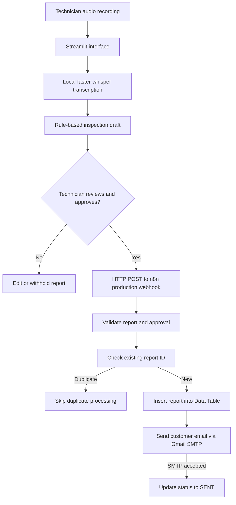

# AutoService AI 2.0

**Technician-reviewed vehicle inspection reporting with local speech recognition and n8n automation**

AutoService AI 2.0 is a proof-of-concept workflow that converts a technician's spoken vehicle inspection into a structured report, requires human review and approval, and submits the approved report to an n8n workflow for customer email delivery and status tracking.

> **Scope:** A local demonstration of AI-assisted documentation and event-driven automation. It is **not** an autonomous vehicle diagnostic system, and its draft recommendations must be reviewed by a qualified technician.

## Engineering problem

Technicians often record inspection findings in unstructured speech or notes. Turning those findings into consistent customer communications can require repetitive manual transcription, formatting, and follow-up. This prototype explores how local speech AI and workflow automation can reduce that administrative work while keeping a technician responsible for the final report.

## System architecture



## Implemented features

- **Local transcription:** Uses `faster-whisper` (`tiny.en`, CPU/int8) to transcribe uploaded technician audio.
- **Structured draft:** Uses transparent keyword rules to suggest complaint and recommendation text while preserving the transcript as an observation draft. This is **not** a trained fault-classification or diagnosis model.
- **Human-in-the-loop review:** Allows technicians to edit the transcript, complaint, observation, and recommendation; explicit approval is required before submission.
- **Webhook integration:** Sends a JSON report from Streamlit to an active n8n production webhook.
- **Workflow automation:** n8n validates the report, checks for an existing report ID, stores a new report, sends an email, and updates its status to `SENT` after successful SMTP submission.
- **Report traceability:** Each new draft receives a generated report ID; Streamlit also prevents a repeat submission of that ID within the current session.

## Technology stack

| Layer | Technology |
|---|---|
| Interface | Python, Streamlit |
| Speech recognition | faster-whisper |
| Draft extraction | Python keyword-based rules |
| API integration | HTTP/JSON, `requests` |
| Workflow orchestration | n8n (Docker) |
| Prototype storage | n8n Data Tables |
| Email | Gmail SMTP, configured inside n8n |

## Project structure

```text
AutoServiceAI/
├── app.py                 # Streamlit application
├── create_demo.py         # Demo recording utility
├── demo_inspection.wav    # Sample audio (use synthetic content only)
├── requirements.txt       # Python dependencies
├── README.md
├── .gitignore
└── .streamlit/
    └── secrets.toml       # Local only: NEVER commit
```

The n8n workflow is configured separately in the local n8n instance. An exported workflow JSON can be added to the repository **after removing credentials, personal information, and private endpoint details**.

## Local setup

### 1. Install Python dependencies

On Windows PowerShell:

```powershell
cd D:\AutoServiceAI
python -m venv .venv
.\.venv\Scripts\Activate.ps1
python -m pip install -r requirements.txt
```

**Dependency note:** The original development environment used `faster-whisper==1.2.1` and `av==19.0.1`. A previous environment required a manual workaround for an audio-decoding API incompatibility. A clean-environment transcription test is still required before the repository can claim reproducible installation.

### 2. Configure n8n

Run an n8n instance with persistent storage, then configure a workflow that:

1. Receives an HTTP `POST` at a production webhook.
2. Validates required report fields and the technician approval flag.
3. Looks up `report_id` in an `autoservice_reports` Data Table.
4. Skips already-existing report IDs; otherwise inserts a new record.
5. Sends the customer email using a separately configured SMTP credential.
6. Updates the stored record to `SENT` and records `sent_at` after SMTP submission succeeds.

Create Data Table columns: `report_id`, `customer_email`, `vehicle_type`, `status`, `created_at`, `sent_at`.

**Important:** n8n's simple lookup-then-insert check is not atomic under concurrent requests. Production deployments should use a unique database constraint, authentication, retries, and explicit failure handling.

### 3. Configure Streamlit secrets

Create `.streamlit/secrets.toml` locally:

```toml
N8N_WEBHOOK_URL = "http://localhost:5678/webhook/REPLACE_WITH_YOUR_PRODUCTION_PATH"
```

Use the **Production URL** from the published/active n8n Webhook node. The Streamlit app does **not** need SMTP credentials; configure them in n8n only. Do not commit the secrets file or publish a real customer address.

### 4. Run the application

```powershell
streamlit run app.py
```

Upload a sample recording, transcribe it, review and correct the generated fields, provide a test email address you control, approve the report, and submit it to n8n. Confirm the workflow execution and `SENT` status in the Data Table.

## Example webhook payload

```json
{
  "report_id": "EV-DEMO-001",
  "customer_email": "test@example.com",
  "approved": true,
  "vehicle_type": "Electric Vehicle",
  "complaint": "Reported reduction in driving range",
  "observation": "Technician reports reduced range and requests a battery health check.",
  "recommendation": "Review battery/BMS diagnostic logs and verify relevant measurements",
  "transcript": "The customer reports reduced driving range. Check the battery health."
}
```

This is synthetic sample data. Do not use `test@example.com` for actual delivery tests.

## Current limitations and future work

- The draft uses keyword heuristics, not validated fault diagnosis or a domain-specific language model.
- Transcription quality depends on audio conditions, vocabulary, and model size; no benchmark has been reported.
- SMTP acceptance does not guarantee inbox delivery.
- The webhook currently needs production-grade authentication and abuse protection.
- Duplicate detection should be made atomic using a database uniqueness constraint.
- Add explicit `FAILED` states, retry policies, logging, and integration tests.
- Validate clean-environment audio decoding before claiming reproducibility.
- Evaluate terminology accuracy and reporting quality with consented, de-identified technician recordings.

## Research relevance

The project demonstrates an end-to-end engineering workflow combining unstructured sensor-adjacent human observations, local AI inference, structured information extraction, human validation, and event-driven automation. Future research could investigate domain-adapted speech recognition, evidence-grounded extraction, uncertainty estimation, and integration with vehicle diagnostic data such as BMS logs and fault codes.

## Data and security

Use only synthetic or properly authorized, de-identified demonstration data. Keep customer information, API/webhook secrets, SMTP credentials, local databases, and raw private recordings out of Git. This prototype is intended for research and portfolio demonstration, not direct deployment in a customer-facing service environment.
